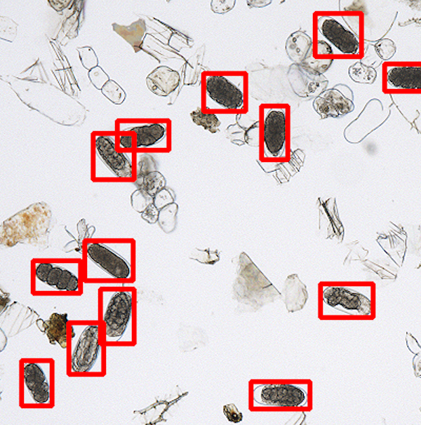

::: {.software-header}
::: {}
NemaQuant uses a custom-trained machine learning model to detect root-knot nematode (RKN)
eggs with human-level accuracy.

To use NemaQuant with no setup required, launch the online version using the button below.
This will take you to the online version, hosted.

**Note**: To save on hosting costs, the online version of NemaQuant goes dormant when not in use.
You may have to wait up to a minute while it spins up again.

[Launch app](https://grin-image-renamer-516395572783.us-central1.run.app){.btn-bi-launcher target="_blank" rel="noopener"}
:::

:::

### Running NemaQuant locally

## External links

[Publication](){.btn-bi-primary}
[Source code](https://github.com/Breeding-Insight/nemaquant){.btn-bi-secondary}

## Good fit for

- Nematologists
- Breeders evaluating nematode resistance in their germplasm
- Anyone counting RKN eggs by hand


```{=html}
<script>
window.addEventListener('load', () => {
  fetch('https://grin-image-renamer-516395572783.us-central1.run.app/')
    .catch(error => console.error('Request failed:', error));
});
</script>
```
