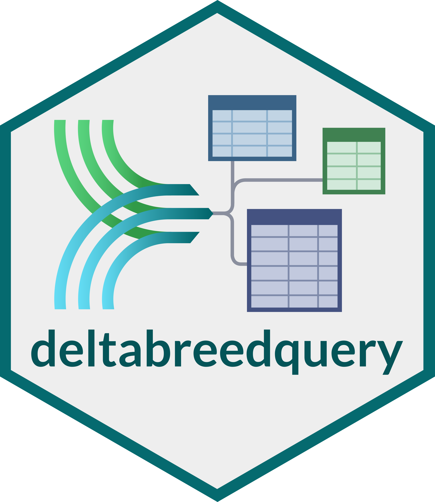

::: {.software-header}
::: {}
The `deltabreedquery` R package provides tools to retrieve data from [DeltaBreed](https://breedinginsight.org/learning-hub/deltabreed/), 
Breeding Insight's breeding data management platform, using the open-source [BrAPI](https://brapi.org/) standard.

With `deltabreedquery`, users can import all of a program's experiments, germplasm, trait definitions, 
and observation (phenotype) data directly into R, without the need to reformat or manually download + read in files. 

Observation data can be filtered on a range of common fields: year, location, trial type, etc.

<div class="meta-row"><span class="pill">R package</span><span class="pill">Breeding data</span><span class="pill">CRAN</span></div>
:::

:::

## Start here

```r
install.packages("BIGr")
library(BIGr)

login_deltabreed("example")

germ <- get_germplasm()
expts <- get_experiments()
traits <- get_variables()
obs <- get_observations()
filt <- filter_observations(location = "Manitoba")
```

## Good fit for

- R users
- Breeders who need to quickly aggregate field trial data to make selections
- Programs that are currently using DeltaBreed
- Programs that are considering or in the process of adopting DeltaBreed


## External links

[CRAN](https://cran.r-project.org/package=deltabreedquery){.btn-bi-primary}
[Source code](https://github.com/Breeding-Insight/deltabreedquery){.btn-bi-secondary}

## Related learning

- [Using deltabreedquery to fetch data from DeltaBreed](../learn/deltabreedquery-basics.qmd)
